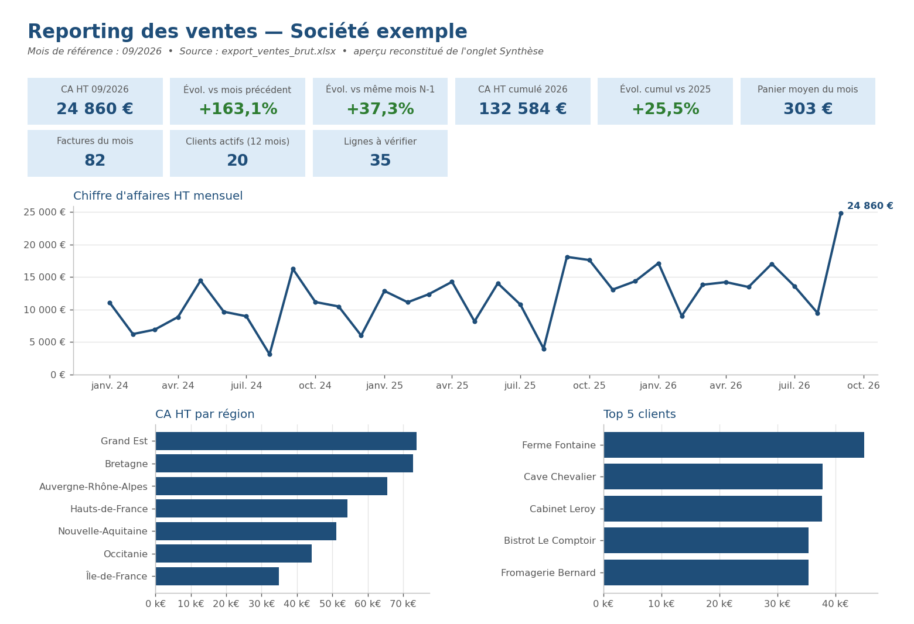
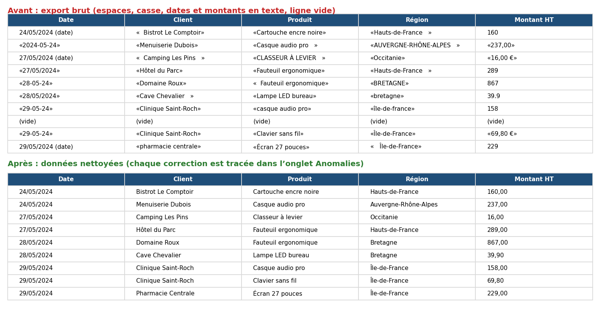
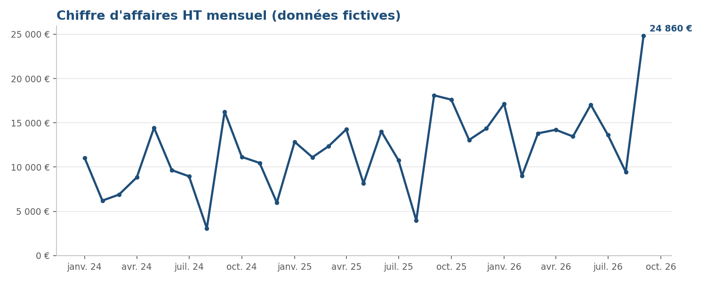

# Reporting Excel automatique à partir d'un export brut

Transformer un export de ventes « tel qu'il sort du logiciel » en classeur de reporting propre,
en une commande, sans retouche manuelle.

> **English summary.** A small, tested Python tool (pandas + openpyxl) that turns a messy sales export
> (mixed date formats, duplicates, stray spaces, inconsistent casing, blank rows, amounts stored as text)
> into a formatted Excel report: KPI summary, monthly revenue with month-over-month and year-over-year
> change, region / top-customer / top-product tables, native Excel charts, a data-quality sheet listing
> every correction, and the cleaned data. A VBA module offers the basic cleaning + pivot table for teams
> that want to stay 100 % in Excel. All data in this repository is synthetic.



*Aperçu reconstitué de l'onglet « Synthèse » (même calcul, rendu matplotlib). Le classeur réel est dans
[`exemples/reporting_exemple.xlsx`](exemples/reporting_exemple.xlsx).*

## Le problème

Chaque mois, quelqu'un exporte les ventes depuis l'ERP, la caisse ou le logiciel de facturation, puis passe
plusieurs heures à :

- remettre les dates au bon format (`15/03/2025`, `2025-03-15`, `15-03-25`… dans la même colonne) ;
- convertir les montants restés en texte (`"1 234,50 €"`), que `SOMME()` ignore sans prévenir ;
- supprimer les doublons et les lignes vides ;
- regrouper `BRETAGNE`, `bretagne` et `Bretagne ` qui apparaissent comme trois régions différentes ;
- refaire les mêmes tableaux et graphiques que le mois précédent.

C'est long, répétitif, et une erreur passe facilement inaperçue.

## Avant / après



| | Avant | Après |
|---|---|---|
| Fichier | `data/export_ventes_brut.xlsx` (1 483 lignes) | `exemples/reporting_exemple.xlsx` (7 onglets) |
| Dates | 5 formats différents, une date impossible (31/02) | une seule colonne de vraies dates Excel |
| Montants | 736 valeurs stockées en texte | nombres, prêts pour les calculs |
| Libellés | casse et espaces incohérents | 20 clients, 12 produits, 7 régions, sans variantes |
| Doublons, lignes vides | 24 doublons, 6 lignes vides | supprimés, et listés |
| Reporting | à refaire à la main | généré en quelques secondes |

Le script **ne supprime rien en silence** : chaque ligne écartée ou à vérifier est listée dans l'onglet
« Anomalies » avec son numéro de ligne dans le fichier d'origine.

## Ce que contient le classeur produit

| Onglet | Contenu |
|---|---|
| Synthèse | indicateurs du mois (CA HT, évolution M-1 et N-1, cumul annuel vs N-1, panier moyen, factures, clients actifs, lignes à vérifier) et 3 graphiques |
| CA mensuel | CA HT et nombre de factures par mois, évolutions M-1 / N-1 en vert / rouge, courbe |
| Régions | CA HT, part du CA, nombre de clients par région, histogramme |
| Top clients / Top produits | les 10 premiers (paramétrable), part du CA, histogramme |
| Anomalies | corrections automatiques (comptées) et lignes exclues ou à vérifier (détaillées) |
| Données nettoyées | toutes les lignes retenues, en tableau Excel filtrable, avec le n° de ligne source |

Les graphiques sont des **graphiques Excel natifs** (modifiables dans Excel), pas des images.



## Utilisation

Prérequis : Python 3.9 ou plus récent.

```bash
python -m venv .venv
source .venv/bin/activate          # Windows : .venv\Scripts\activate
pip install -r requirements.txt

python report.py data/export_ventes_brut.xlsx -o reporting.xlsx
```

Options utiles :

```bash
python report.py export.xlsx -o reporting.xlsx --mois 2026-06       # mois de référence (défaut : le dernier)
python report.py export.xlsx -o reporting.xlsx --top 15             # taille des tops clients / produits
python report.py export.xlsx -o reporting.xlsx --onglet "Ventes"    # onglet à lire (défaut : le premier)
python report.py export.xlsx -o reporting.xlsx --societe "Ma PME"   # nom affiché dans le titre
```

Autres scripts :

```bash
python generate_sample.py      # régénère le fichier d'exemple fictif
python make_screenshots.py     # régénère les images de ce README
pytest                         # lance les tests (nettoyage, agrégats, bout en bout)
```

## Version 100 % Excel (VBA)

Pour les équipes qui ne veulent rien installer, [`vba/ReportingVentes.bas`](vba/ReportingVentes.bas) contient
une macro `NettoyerEtCreerTCD` qui fait le nettoyage de base et un tableau croisé dynamique
(CA HT par mois et par région). Elle ne modifie pas l'onglet d'origine.

**Importer le module**

1. Ouvrir l'export dans Excel, puis l'éditeur VBA : `Alt + F11` (Mac : *Outils > Macro > Visual Basic Editor*).
2. *Fichier > Importer un fichier…* et choisir `ReportingVentes.bas`.
3. Fermer l'éditeur, se placer sur l'onglet des données (en-têtes en ligne 1).
4. `Alt + F8` (Mac : *Outils > Macro > Macros…*), choisir `NettoyerEtCreerTCD`, *Exécuter*.
5. Pour garder la macro dans le fichier, l'enregistrer au format `.xlsm`.

La macro crée deux onglets : « Données nettoyées » (tableau Excel, lignes à vérifier surlignées en orange,
colonne « Anomalie ») et « TCD ». Elle est plus simple que la version Python : pas de synthèse KPI ni de
graphiques, et l'harmonisation de la casse retient la première graphie en casse mixte rencontrée.

## Ce qui est personnalisable

- **Noms de colonnes** : chaque logiciel a ses intitulés (« Raison sociale », « Total HT », « Désignation »…).
  Ils se déclarent dans `COLUMNS` (`reporting/cleaning.py`) ou dans les constantes `COL_…` du module VBA.
- **Règles de nettoyage** : formats de date acceptés, tolérance sur le contrôle HT + TVA = TTC,
  traitement des lignes sans client.
- **Indicateurs et tableaux** : marge, CA par commercial, par famille de produits, objectifs vs réalisé,
  comparaison à budget… (`reporting/aggregates.py`).
- **Mise en forme** : couleurs, nom de la société, ordre des onglets (`reporting/excel_report.py`).
- **Sources multiples** : plusieurs exports à concaténer (un par mois, un par agence), CSV, extraction ERP.

## Délai typique pour l'adapter à un vrai fichier

À titre indicatif, pour un export unique de structure stable :

- **1 à 2 jours** : correspondance des colonnes, règles de nettoyage propres au fichier, indicateurs standard,
  test sur 2 ou 3 mois réels ;
- **3 à 5 jours** si plusieurs sources doivent être rapprochées ou si des indicateurs spécifiques
  (marge, objectifs, budget) sont demandés.

Le délai réel dépend surtout de l'état des données ; un échantillon anonymisé permet de l'estimer avant
de commencer.

## Organisation du code

```
report.py                 commande principale
reporting/cleaning.py     lecture, nettoyage, contrôles qualité
reporting/aggregates.py   CA mensuel, M-1 / N-1, régions, tops, indicateurs
reporting/excel_report.py classeur mis en forme, graphiques natifs
generate_sample.py        génération des données fictives
make_screenshots.py       images du README
vba/ReportingVentes.bas   équivalent VBA (nettoyage + tableau croisé)
tests/                    tests pytest
```

## Données

Toutes les données de ce dépôt sont **fictives**, générées par `generate_sample.py` : les noms de clients,
produits et commerciaux sont inventés. Aucune donnée client réelle n'est utilisée.

## Licence

MIT, voir [LICENSE](LICENSE).
